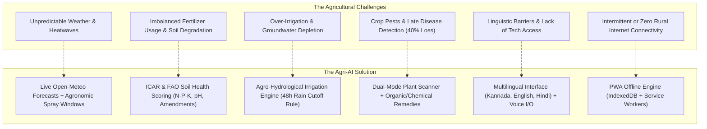
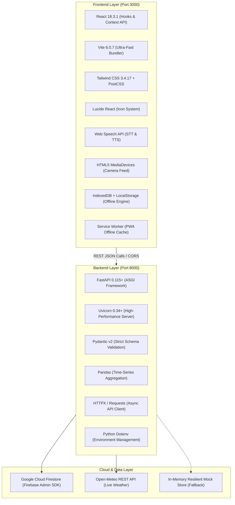
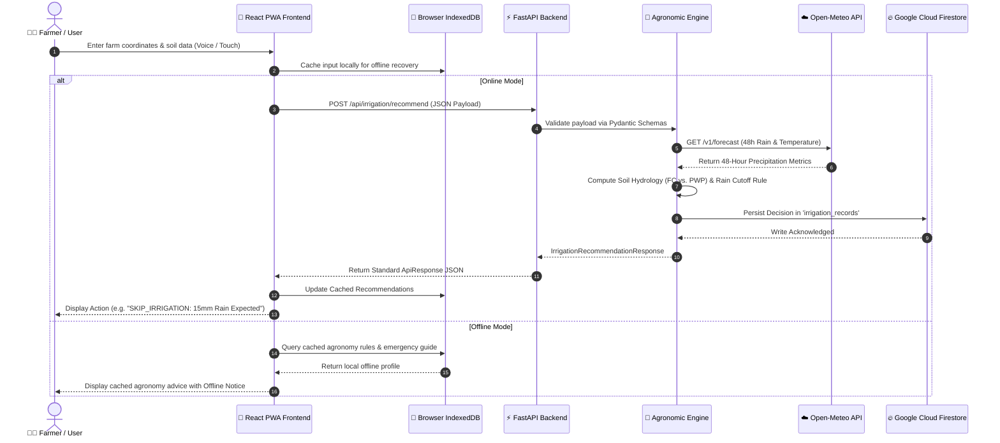

# Agri-AI – Intelligent Precision Agriculture Platform 🌱🌾

[](https://fastapi.tiangolo.com)
[](https://www.python.org/)
[](https://react.dev/)
[](https://vitejs.dev/)
[](https://tailwindcss.com/)
[](https://firebase.google.com/)
[](https://open-meteo.com/)
[](LICENSE)

> An end-to-end, full-stack, AI-powered agricultural intelligence platform designed to empower smallholder and commercial farmers with real-time weather analytics, ICAR-calibrated soil health screening, location-based crop suitability matching, dynamic irrigation scheduling, crop growth calendars, dual-mode plant disease diagnosis, farm water asset tracking, and multilingual voice-guided advisories.

---

## 📌 Table of Contents

- [Overview & Introduction](#-overview--introduction)
- [Problem Statement & Proposed Solution](#-problem-statement--proposed-solution)
- [Key Features](#-key-features)
- [Technology Stack](#-technology-stack)
- [System Architecture](#-system-architecture)
- [End-to-End System Workflow](#-end-to-end-system-workflow)
- [Core Modules Deep Dive](#-core-modules-deep-dive)
  - [1. Weather Intelligence & Alert Engine](#1-weather-intelligence--alert-engine)
  - [2. Soil Health Analyzer & Fertilizer Guidance](#2-soil-health-analyzer--fertilizer-guidance)
  - [3. Location-Based Crop Recommendation](#3-location-based-crop-recommendation)
  - [4. Smart Irrigation & Rain Cutoff Engine](#4-smart-irrigation--rain-cutoff-engine)
  - [5. Smart Crop Growth Calendar](#5-smart-crop-growth-calendar)
  - [6. Farm Water Availability & Shortage Management](#6-farm-water-availability--shortage-management)
  - [7. Plant Disease Scanner & Remedies](#7-plant-disease-scanner--remedies)
  - [8. Multilingual AI Voice Assistant & Offline Storage](#8-multilingual-ai-voice-assistant--offline-storage)
- [REST API Endpoints Directory](#-rest-api-endpoints-directory)
- [Project Directory Structure](#-project-directory-structure)
- [Installation & Setup Guide](#-installation--setup-guide)
  - [Backend Setup (FastAPI)](#backend-setup-fastapi)
  - [Frontend Setup (React + Vite)](#frontend-setup-react--vite)
- [Testing & Quality Assurance](#-testing--quality-assurance)
- [Application Screenshots](#-application-screenshots)
- [Future Enhancements](#-future-enhancements)
- [Contributors & Team](#-contributors--team)
- [License & Agronomic Disclaimer](#-license--agronomic-disclaimer)

---

## 📖 Overview & Introduction

**Agri-AI** bridges the gap between complex agronomic science and on-the-ground farming decisions. Agriculture in developing and emerging agricultural economies faces intense climate variability, unpredictable rainfall, soil degradation due to unscientific fertilization, and catastrophic crop losses from late disease detection.

Built as an integrated **Progressive Web Application (PWA)** backed by a **FastAPI** microservice and **Google Cloud Firestore**, Agri-AI gives farmers actionable, localized, and scientifically backed advisories in their native tongue (**Kannada, English, and Hindi**) through text, touch, and speech.

Whether online in an irrigated belt or working offline in a remote rainfed village, Agri-AI equips farmers with the digital intelligence required to maximize crop yield, slash input costs, conserve groundwater, and safeguard livelihoods.

---

## 🎯 Problem Statement & Proposed Solution



### 1. The Challenges:
* **Climate Volatility:** Traditional farmers rely on historical seasonal intuition, which fails under sudden weather shifts, unseasonal rains, and extreme heatwaves.
* **Nutrient Imbalance:** Blind overuse of subsidized synthetic fertilizers (like Urea) causes soil acidification, micronutrient lockup, and wasted capital.
* **Water Scarcity:** Flood irrigation drains tube wells and depletes groundwater tables, while over-watering during unneeded pre-rain periods causes root rot and power waste.
* **Crop Diseases:** Fungal, bacterial, and viral diseases spread unchecked without immediate identification and treatment guidance.
* **Connectivity & Language Gap:** Complex English apps requiring 5G internet alienate rural farmers who need hands-free speech input in regional languages.

### 2. The Agri-AI Approach:
* **Localized Intelligence:** Fetches exact coordinates via GPS or interactive Google Maps to pull real-time weather analytics.
* **Scientifically Calibrated:** Rules and scoring calibrated against benchmarks from the **Indian Council of Agricultural Research (ICAR)**, **UAS Bangalore / Dharwad**, and **FAO**.
* **Zero Waste Irrigation:** Automatically analyzes 48-hour precipitation forecasts to tell farmers when to skip pumping, saving water and electricity.
* **Offline Resilience:** IndexedDB and Service Workers cache records, emergency crop guides, and diagnostic data locally on the device.

---

## 🌟 Key Features

| Feature Pillar | Capabilities & Highlights |
| :--- | :--- |
| **🌦️ Agro-Meteorology & Alerts** | Real-time temperature, humidity, wind speed, rainfall probability, apparent temperature, and WMO weather decoding. Generates automated warnings for heatwaves ($\ge 38^\circ\text{C}$), heavy rainfall ($\ge 30\text{ mm}$), gale-force winds, and fungal risk periods. Computes pesticide/fertilizer spraying suitability windows. |
| **🧪 Soil Health Analyzer** | Evaluates soil pH, Available Nitrogen ($N$), Phosphorus ($P_2O_5$), Potassium ($K_2O$), organic carbon, and moisture. Computes a 0–100 Soil Health Score, classifies soil texture (Red, Black, Sandy Loam, Clayey, Laterite), and provides step-by-step biofertilizer and liming amendments. |
| **🌾 100-Point Crop Recommendation** | Multi-factor agronomic engine analyzing farm coordinates, agro-climatic zone, season (Kharif, Rabi, Summer), soil texture, pH compatibility, and irrigation availability to rank crops with suitability scores, water demands, and viable alternatives. |
| **💧 Smart Irrigation Advisory** | Evaluates crop phenology (e.g. critical flowering vs. maturity), soil field capacity, wilting points, and 48-hour rainfall forecasts to issue `IRRIGATE_NOW`, `DELAY_IRRIGATION`, `SKIP_IRRIGATION`, or `DRAIN_EXCESS_WATER` directives. |
| **📅 Smart Crop Growth Calendar** | Variety-specific crop growth timeline (Maize 105d, Paddy 130d, Ragi 115d) with estimated calendar milestone dates, critical moisture alert windows, pest-scouting reminders, and harvesting advisories. |
| **🌊 Water Asset Management** | Tracks farm water infrastructure (borewells, open wells, farm ponds, canals, rainwater storage), calculates daily discharge vs. capacity, and computes water security indices and shortage alerts. |
| **📸 Plant Disease Scanner** | Dual-mode capture: Live Rear/Front camera preview (MediaDevices API) and Photo Gallery upload. Identifies crop diseases (e.g. Early Blight, Powdery Mildew, Yellow Rust) with organic bio-treatments and chemical sprays. |
| **🗣️ Multilingual & Voice Assistant** | Complete UI and advisory translation across **Kannada (ಕನ್ನಡ)**, **English**, and **Hindi (हिन्दी)**. Features Speech-to-Text voice queries and Text-to-Speech audio readout for hands-free operation in the field. |
| **📱 PWA & Offline Protection** | Progressive Web App with Service Worker (`sw.js`) and Web Manifest. High-capacity offline storage powered by browser IndexedDB for farmer profiles, logs, and emergency agronomy guides. |
| **🗺️ Google Maps Farm Plotting** | GPS farm boundary identification and coordinates selection with interactive farm plot canvas fallback. Stores farmer profiles and farm coordinates in Google Cloud Firestore. |

---

## 🛠️ Technology Stack



### Detailed Stack Breakdown:

* **Frontend:**
  * **Framework:** React 18.3.1 (`react`, `react-dom`)
  * **Build System:** Vite 6.0.7
  * **CSS Framework:** Tailwind CSS 3.4.17 with PostCSS & Autoprefixer
  * **Iconography:** `lucide-react` 1.16.0
  * **Device & Hardware APIs:**
    * `navigator.mediaDevices.getUserMedia` for rear/front camera preview
    * `window.webkitSpeechRecognition` / `SpeechRecognition` for voice input
    * `window.speechSynthesis` for spoken voice responses
    * `Notification` API for browser push reminders
    * `ServiceWorker` & Web App Manifest for PWA installation
* **Backend:**
  * **Language:** Python 3.10+ (tested through 3.13)
  * **Web Framework:** FastAPI 0.115+
  * **ASGI Web Server:** Uvicorn 0.34+
  * **Data Validation:** Pydantic v2 with alias choices and schema enforcement
  * **Data Analytics:** Pandas (for 7-day weather trend aggregation)
  * **Networking:** HTTPX & Requests with automatic timeouts and error trapping
* **Database & Cloud:**
  * **Cloud Database:** Google Cloud Firestore via Firebase Admin SDK
  * **Collections (7):** `farmers`, `soil_records`, `weather_records`, `crop_recommendations`, `irrigation_records`, `crop_calendars`, `water_records`
  * **Fault Tolerance:** Transparent in-memory mock store fallback when offline or credentials are not yet configured.
* **Testing & Tools:**
  * **Test Runners:** Pytest 9.2+, `fastapi.testclient` / Starlette
  * **Documentation:** OpenAPI Swagger UI (`/docs`), ReDoc (`/redoc`)

---

## 🏛️ System Architecture

The Agri-AI platform follows a **decoupled, modular micro-architecture** ensuring that user experience, business logic, offline caching, and cloud persistence operate seamlessly:

```mermaid
flowchart TD
    %% Styling
    classDef client fill:#E8F5E9,stroke:#2E7D32,stroke-width:2px;
    classDef gateway fill:#E1F5FE,stroke:#0277BD,stroke-width:2px;
    classDef service fill:#FFF3E0,stroke:#EF6C00,stroke-width:2px;
    classDef data fill:#F3E5F5,stroke:#7B1FA2,stroke-width:2px;

    subgraph ClientLayer["1. Client Presentation Layer (React + Vite PWA)"]
        UI_Home["Homepage & Weather Widget"]:::client
        UI_Weather["Weather & Alerts Center"]:::client
        UI_Soil["Soil Health & Fertilizer Modal"]:::client
        UI_Crop["Crop Recommendation Engine"]:::client
        UI_Irrig["Smart Irrigation Dashboard"]:::client
        UI_Cal["Farming Calendar & Reminders"]:::client
        UI_Dis["Plant Disease Camera Scanner"]:::client
        UI_Loc["Location & Google Maps Picker"]:::client
        UI_Voice["Multilingual Voice Assistant"]:::client
        Client_DB["IndexedDB & Service Worker (PWA Offline)"]:::client
    end

    subgraph GatewayLayer["2. API Gateway & Middleware (FastAPI)"]
        CORS["CORS Middleware (3000, 5173, *)"]:::gateway
        Docs["OpenAPI Swagger UI (/docs)"]:::gateway
        Router["FastAPI Application Core (main.py)"]:::gateway
    end

    subgraph ServicesLayer["3. Agronomic Services & Intelligence Engines"]
        S_Weather["WeatherService (WMO Decode + Pandas Aggregation)"]:::service
        S_Soil["SoilService (ICAR / FAO Nutrient Classification)"]:::service
        S_Crop["CropService (100-Point Agro-Climatic Suitability)"]:::service
        S_Irrig["IrrigationService (Agro-Hydrology + Rain Cutoff)"]:::service
        S_Cal["CalendarService (Variety Growth Timelines)"]:::service
        S_Water["WaterService (Farm Water Asset Tracking)"]:::service
        S_Loc["LocationService (Farmer GPS & Profile Management)"]:::service
    end

    subgraph DataLayer["4. Cloud & External Services"]
        API_OM["Open-Meteo REST Service (No Key Required)"]:::data
        DB_FS["Google Cloud Firestore (7 Managed Collections)"]:::data
        DB_Mock["Safe In-Memory Fallback Store"]:::data
    end

    %% Connections
    UI_Home & UI_Weather & UI_Soil & UI_Crop & UI_Irrig & UI_Cal & UI_Loc --> CORS
    UI_Home & UI_Cal & UI_Dis -.-> Client_DB
    CORS --> Router
    Router --> Docs
    Router --> S_Weather & S_Soil & S_Crop & S_Irrig & S_Cal & S_Water & S_Loc

    S_Weather --> API_OM
    S_Soil & S_Crop & S_Irrig & S_Cal & S_Water & S_Loc --> DB_FS
    DB_FS -.->|Failover| DB_Mock
```



---

## 🔄 End-to-End System Workflow

The following sequence illustrates how a farmer's request (e.g., getting weather, analyzing soil, or requesting smart irrigation advice) flows through Agri-AI:



---

## 🔬 Core Modules Deep Dive

### 1. Weather Intelligence & Alert Engine
* **Source:** [`backend/app/services/weather_service.py`](backend/app/services/weather_service.py), [`backend/app/api/weather.py`](backend/app/api/weather.py)
* **API Integration:** Connects to Open-Meteo without requiring API keys.
* **WMO Decoder:** Maps numeric WMO weather codes (0–99) to human-readable agricultural descriptions (e.g. *Clear sky, Dense drizzle, Thunderstorm with slight hail*).
* **Spraying Suitability Window:** Evaluates wind speed, rainfall, and humidity to tell farmers whether foliar pesticide or fertilizer application is `SUITABLE`, `MARGINAL`, or `UNSUITABLE`.
* **Hazard Alert Engine:** Configurable thresholds trigger alerts for:
  * Extreme Heat ($\ge 38^\circ\text{C}$)
  * Heavy Rainfall / Waterlogging ($\ge 30\text{ mm}$)
  * Strong Wind Lodging Risk ($\ge 35\text{ km/h}$)
  * Frost & Cold Stress ($\le 4^\circ\text{C}$)
  * High Humidity Fungal Risk ($\ge 85\%$)

### 2. Soil Health Analyzer & Fertilizer Guidance
* **Source:** [`backend/app/services/soil_service.py`](backend/app/services/soil_service.py), [`backend/app/api/soil.py`](backend/app/api/soil.py)
* **Agronomic Benchmarks:** Strictly adheres to ICAR and FAO soil testing classification standards:
  * **Nitrogen ($N$):** Deficient ($< 280\text{ kg/ha}$), Optimal ($280 - 560\text{ kg/ha}$), Excess ($> 560\text{ kg/ha}$)
  * **Phosphorus ($P_2O_5$):** Deficient ($< 23\text{ kg/ha}$), Optimal ($23 - 57\text{ kg/ha}$), Excess ($> 57\text{ kg/ha}$)
  * **Potassium ($K_2O$):** Deficient ($< 145\text{ kg/ha}$), Optimal ($145 - 337\text{ kg/ha}$), Excess ($> 337\text{ kg/ha}$)
  * **Soil pH:** Strongly Acidic ($< 5.5$), Moderately Acidic ($5.5 - 6.4$), Optimal/Neutral ($6.5 - 7.5$), Moderately Alkaline ($7.6 - 8.5$), Strongly Alkaline ($> 8.5$)
* **Soil Health Score:** Computes a composite 0–100 score (`EXCELLENT`, `GOOD`, `FAIR`, `POOR`) with tailored biofertilizer advice (*Rhizobium, Azotobacter, PSB*) and agricultural lime amendments.

### 3. Location-Based Crop Recommendation
* **Source:** [`backend/app/services/crop_service.py`](backend/app/services/crop_service.py), [`backend/app/api/crops.py`](backend/app/api/crops.py)
* **Scoring Architecture:** Transparent 100-point multi-factor decision matrix calibrated for Indian agro-climatic zones:
  $$\text{Score} = S_{\text{climate}} (30\text{ pts}) + S_{\text{soil-pH}} (25\text{ pts}) + S_{\text{water}} (25\text{ pts}) + S_{\text{season}} (20\text{ pts})$$
* **Output:** Recommends primary crops (e.g. *Paddy, Sugarcane, Maize, Ragi, Wheat, Cotton*) with variety suggestions, water requirements, and resilient secondary alternatives.

### 4. Smart Irrigation & Rain Cutoff Engine
* **Source:** [`backend/app/services/irrigation_service.py`](backend/app/services/irrigation_service.py), [`backend/app/api/irrigation.py`](backend/app/api/irrigation.py)
* **Hydrology Standards:** Incorporates soil physics parameters (Field Capacity & Permanent Wilting Point) for Red Soil ($FC=24\%, PWP=12\%$), Black Soil ($FC=38\%, PWP=20\%$), Sandy Loam, Clayey, and Laterite soils.
* **48-Hour Rain Cutoff Rule:**
  * Forecasted rain $\ge 15\text{ mm} \rightarrow$ **`SKIP_IRRIGATION`** (Zero irrigation required; prevents root asphyxiation, conserves power).
  * Forecasted rain $\ge 7\text{ mm} \rightarrow$ **`DELAY_IRRIGATION`** (Postpone by 24 hours to observe precipitation).
  * Soil moisture critically depleted during flowering/silking $\rightarrow$ **`IRRIGATE_NOW`** (High urgency).
* **Provenance Tracking:** Distinguishes between measured IoT electronic sensor probes and farmer manual estimates.

### 5. Smart Crop Growth Calendar
* **Source:** [`backend/app/services/calendar_service.py`](backend/app/services/calendar_service.py), [`backend/app/api/calendar.py`](backend/app/api/calendar.py)
* **Crop Phenology Database:** Differentiated timelines for **Maize (105 days)**, **Paddy (130 days)**, and **Ragi (115 days)**.
* **Milestone Dates:** Calculates explicit estimated calendar dates for Sowing, Vegetative Growth, Flowering/Silking, Grain Filling, and Harvest.
* **Reminders:** Generates stage-specific irrigation moisture window alerts, pest-scouting reminders (*Fall Armyworm, Blast, Cutworms*), and fertilizer top-dressing intervals.

### 6. Farm Water Availability & Shortage Management
* **Source:** [`backend/app/services/water_service.py`](backend/app/services/water_service.py), [`backend/app/api/water.py`](backend/app/api/water.py)
* **Supported Assets:** Borewells, open wells, farm ponds (*Krishi Honda*), irrigation canals, and rainwater harvesting cisterns.
* **Security Index:** Computes farm water security (`SECURE`, `MODERATE`, `VULNERABLE`, `CRITICAL_SHORTAGE`) and advises on organic mulching and nighttime pumping.

### 7. Plant Disease Scanner & Remedies
* **Source:** [`src/pages/DiseaseDetectionPage.jsx`](src/pages/DiseaseDetectionPage.jsx)
* **Capture Options:** Live camera streaming with front/rear lens switching or gallery upload.
* **Curated Diagnostics:** Diagnoses key crop diseases (*Tomato Early Blight, Wheat Yellow Rust, Powdery Mildew, Citrus Canker*) and provides dual remediation strategies:
  * **Biological/Organic:** *Trichoderma viride*, sour buttermilk spray, cold-pressed Neem oil (1500 ppm).
  * **Chemical:** *Mancozeb 75% WP*, *Propiconazole 25% EC*, *Azoxystrobin*.

### 8. Multilingual AI Voice Assistant & Offline Storage
* **Source:** [`src/services/aiChatService.js`](src/services/aiChatService.js), [`src/utils/indexedDBStorage.js`](src/utils/indexedDBStorage.js), [`src/context/LanguageContext.jsx`](src/context/LanguageContext.jsx)
* **Supported Languages:** **Kannada (ಕನ್ನಡ)** (Default), **English**, and **Hindi (हिन्दी)**.
* **Voice Capabilities:** Web Speech API recognition converts spoken farmer queries into text; speech synthesis reads advisory instructions aloud in the chosen language.
* **IndexedDB Store:** Stores offline farm logs, crop templates, and emergency guidelines locally.

---

## 📡 REST API Endpoints Directory

All backend responses adhere strictly to the standardized `ApiResponse` envelope:
```json
{
  "success": true,
  "message": "Status description",
  "data": { ... }
}
```

| HTTP Method | Endpoint URL | Parameters / Request Body | Description |
| :---: | :--- | :--- | :--- |
| `GET` | `/` | None | Service welcome message, version, and documentation links |
| `GET` | `/health` | None | Health check & database connection status |
| `GET` | `/api/weather/current` | `latitude`, `longitude` (Query) | Live temperature, humidity, wind, rainfall, and spray suitability window |
| `GET` | `/api/weather/forecast` | `latitude`, `longitude` (Query) | 7-day daily forecast and Pandas-aggregated statistical summaries |
| `GET` | `/api/weather/alerts` | `latitude`, `longitude` (Query) | Extreme heat, heavy rainfall, frost, wind, and fungal alerts |
| `POST` | `/api/soil/analyze` | `ph`, `nitrogen`, `phosphorus`, `potassium`, `soil_type`, `soil_moisture_pct` | ICAR soil health score (0–100), nutrient analysis & organic amendments |
| `POST` | `/api/crops/recommend` | `latitude`, `longitude`, `district`, `season`, `soil_type`, `water_availability` | 100-point crop suitability rankings, water demands, and alternative crops |
| `POST` | `/api/irrigation/recommend` | `crop_name`, `crop_stage`, `soil_type`, `soil_moisture_pct`, `rainfall_forecast_mm` | Dynamic irrigation advice (`IRRIGATE_NOW`, `SKIP_IRRIGATION`), rain warnings |
| `POST` | `/api/calendar/generate` | `crop_name`, `sowing_date`, `variety`, `season`, `district`, `farmer_id` | Stage-by-stage growth timeline with estimated dates and monitoring alerts |
| `GET` | `/api/calendar/{farmer_id}` | `farmer_id` or crop name (`maize`, `paddy`, `ragi`) | Retrieves saved calendar or dynamically builds variety calendar |
| `POST` | `/api/water/register` | `farmer_id`, `water_sources` (borewell, well, pond, canal, rainwater) | Registers farm water assets and computes water security dashboard |
| `GET` | `/api/water/{farmer_id}` | `farmer_id` (Path) | Retrieves farmer water availability profile and shortage warnings |
| `PUT` | `/api/water/{farmer_id}` | `farmer_id`, updated capacities | Updates water assets after recharge or pond depletion |
| `GET` | `/api/water/regional/availability` | `latitude`, `longitude` (Query) | Regional precipitation balance and groundwater vulnerability rating |
| `POST` | `/api/location/farmers` | `farmer_name`, `phone`, `village`, `district`, `latitude`, `longitude`, `area_acres` | Stores farmer profile and farm GPS coordinates in Firestore |
| `GET` | `/api/location/farmers` | None | Lists all registered farmers and coordinates for Google Maps plotting |
| `GET` | `/api/location/farmers/{id}` | `farmer_id` (Path) | Retrieves single farmer profile and farm parameters |
| `GET` | `/api/location/database/status` | None | Firestore live connection state and counts across all 7 collections |

---

## 📂 Project Directory Structure

```text
d:\hackathon\
├── backend/                               # Python FastAPI Microservice
│   ├── app/
│   │   ├── main.py                        # FastAPI entry point, CORS, routers & exception handlers
│   │   ├── config.py                      # Central settings, thresholds & env auto-resolution
│   │   ├── api/                           # Feature API Endpoints
│   │   │   ├── weather.py                 # Real-time observations, 7-day forecast & alerts
│   │   │   ├── soil.py                    # ICAR soil health screening & fertilizer advice
│   │   │   ├── crops.py                   # 100-point location-based crop suitability
│   │   │   ├── irrigation.py              # Agro-hydrological irrigation & rain cutoff
│   │   │   ├── calendar.py                # Variety growth timelines & stage reminders
│   │   │   ├── water.py                   # Water asset registration & shortage dashboard
│   │   │   └── location.py                # Farmer GPS coordinates & Firestore status
│   │   ├── services/                      # Agronomic Algorithms & Integrations
│   │   │   ├── weather_service.py         # Open-Meteo client & hazard rule evaluator
│   │   │   ├── soil_service.py            # ICAR/FAO soil screening & biofertilizer advice
│   │   │   ├── crop_service.py            # Multi-factor crop ranking algorithm
│   │   │   ├── irrigation_service.py      # Soil moisture vs. rainfall decision engine
│   │   │   ├── calendar_service.py        # Variety-specific lifecycle timelines
│   │   │   └── water_service.py           # Farm water asset analytics & conservation tips
│   │   ├── models/
│   │   │   └── schemas.py                 # Strict Pydantic models with validation & aliases
│   │   ├── database/
│   │   │   └── firebase.py                # Firestore SDK client (7 collections) with fallback
│   │   └── utils/
│   │       └── helpers.py                 # Unified ApiResponse serialization wrapper
│   ├── tests/                             # Automated Test Suites
│   │   ├── test_master_integration.py     # 20 Master integration tests covering all APIs
│   │   ├── test_structure.py              # Modularity & core logic unit tests
│   │   ├── test_weather_live.py           # Live Open-Meteo test for Mysuru, Karnataka
│   │   ├── test_soil_live.py              # Multi-sample soil analysis verification
│   │   ├── test_crops_live.py             # Multi-zone Karnataka crop suitability tests
│   │   ├── test_irrigation_live.py        # Growth stage & rain cutoff tests
│   │   ├── test_calendar_live.py          # Maize, Paddy, and Ragi growth calendar tests
│   │   ├── test_water_live.py             # Water asset registration & shortage tests
│   │   └── test_firebase_operations.py    # Firestore read/write across all 7 collections
│   ├── requirements.txt                   # Backend Python dependencies
│   ├── .env.example                       # Environment template for backend
│   └── README.md                          # Dedicated Backend Documentation
│
├── public/                                # Static Web & PWA Assets
│   ├── icons/                             # PWA Application Icons (192px, 512px)
│   ├── manifest.json                      # Web App Manifest for PWA installation
│   └── sw.js                              # Service Worker for offline asset caching
│
├── src/                                   # React Frontend Application
│   ├── components/                        # Modular UI Components
│   │   ├── auth/                          # Farmer Login & Registration Modals
│   │   ├── common/                        # Reusable UI Primitives (Button, Card, Badge, Modal)
│   │   ├── dashboard/                     # Farm Analytics Dashboard Widgets & Header
│   │   ├── features/                      # Soil Calculator & Crop Recommendation Modals
│   │   ├── home/                          # Hero Section, Weather Preview, Market Rates
│   │   ├── layout/                        # Responsive Navbar, Footer & Notification Banner
│   │   └── offline/                       # Offline Warning Banner & Offline Help Guide
│   ├── context/                           # React State Contexts
│   │   ├── LanguageContext.jsx            # Trilingual State Switcher (Kannada, English, Hindi)
│   │   └── OfflineContext.jsx             # Network connection monitor & offline toggle
│   ├── data/                              # Seed Data & Reference Lookups
│   │   ├── mockData.js                    # Agricultural district benchmarks
│   │   └── weatherData.js                 # Curated district agro-meteorology fallback
│   ├── pages/                             # Full Screen Application Views
│   │   ├── AIAssistantPage.jsx            # Voice-enabled Multilingual Chat Assistant
│   │   ├── CropRecommendationPage.jsx     # Soil, Water & Climate Crop Matcher Form
│   │   ├── DashboardPage.jsx              # Farmer Overview, Alerts & Farm Quick Stats
│   │   ├── DiseaseDetectionPage.jsx       # Camera Scanner & Disease Diagnosis View
│   │   ├── FarmerProfilePage.jsx          # Farmer Bio & Farm Specifications Form
│   │   ├── FarmingCalendarPage.jsx        # Stage-by-Stage Crop Timeline & Reminders
│   │   ├── LocationSelectionPage.jsx      # GPS Location & Google Maps Picker
│   │   ├── MyFarmingRecordsPage.jsx       # Crop Season Logs, Yields & Photo Records
│   │   └── WeatherPage.jsx                # 7-Day Agricultural Weather & Spray Window
│   ├── services/                          # Frontend Service Adapters
│   │   ├── aiChatService.js               # Trilingual Agronomic Chat Knowledge Engine
│   │   └── farmerDataService.js           # Decoupled IndexedDB & REST API Data Layer
│   ├── utils/                             # Storage, Notifications & Translations
│   │   ├── authStorage.js                 # Session persistence in LocalStorage
│   │   ├── indexedDBStorage.js            # High-capacity browser IndexedDB wrapper
│   │   ├── notificationService.js         # Web Notification API scheduler
│   │   ├── offlineStorage.js              # Offline cache manager
│   │   └── translations.js                # Trilingual Dictionary (Kannada, English, Hindi)
│   ├── App.jsx                            # Main Routing & View State Controller
│   ├── index.css                          # Tailwind CSS custom directives & fonts
│   └── main.jsx                           # React DOM application mount
│
├── .env.example                           # Root environment template
├── .gitignore                             # Protects credentials, venv, and node_modules
├── package.json                           # Frontend dependencies and npm scripts
├── postcss.config.js                      # PostCSS pipeline for Tailwind CSS
├── tailwind.config.js                     # Agricultural theme colors & typography
├── vite.config.js                         # Vite 6 configuration (Port 3000)
└── README.md                              # Master Project Documentation (This File)
```

---

## ⚡ Installation & Setup Guide

### Prerequisites
* **Python:** Version 3.10 or higher installed ([python.org](https://www.python.org/downloads/))
* **Node.js:** Version 18.0 or higher installed ([nodejs.org](https://nodejs.org/))
* **Git:** Installed on your system

---

### Backend Setup (FastAPI)

#### Windows (PowerShell):
```powershell
# 1. Navigate to the backend directory
cd D:\hackathon\backend

# 2. Create Python virtual environment
python -m venv venv

# 3. Enable script execution if restricted
Set-ExecutionPolicy -ExecutionPolicy RemoteSigned -Scope Process

# 4. Activate virtual environment
.\venv\Scripts\Activate.ps1

# 5. Install Python dependencies
pip install -r requirements.txt

# 6. Configure environment variables (Optional - defaults work out of the box)
Copy-Item .env.example .env

# 7. Start the FastAPI development server
uvicorn app.main:app --reload --host 127.0.0.1 --port 8000
```

#### macOS / Linux:
```bash
# 1. Navigate to backend directory
cd backend

# 2. Create and activate virtual environment
python3 -m venv venv
source venv/bin/activate

# 3. Install dependencies
pip install -r requirements.txt

# 4. Start the server
uvicorn app.main:app --reload --host 127.0.0.1 --port 8000
```

* Backend API will be live at: **`http://127.0.0.1:8000`**
* Interactive Swagger Docs: **`http://127.0.0.1:8000/docs`**
* ReDoc Documentation: **`http://127.0.0.1:8000/redoc`**

---

### Frontend Setup (React + Vite)

Open a **new terminal window**:

#### Windows (PowerShell) / macOS / Linux:
```bash
# 1. Navigate to the root directory
cd D:\hackathon

# 2. Install Node.js packages
npm install

# 3. Set up environment variables
# Copy .env.example to .env
cp .env.example .env

# 4. Start Vite development server
npm run dev
```

* Frontend application will be live at: **`http://localhost:3000`**
* Open your browser and navigate to `http://localhost:3000` to interact with Agri-AI.

---

## 🧪 Testing & Quality Assurance

Agri-AI includes an automated test suite verifying all 10 modules across 26 unit and master integration test cases:

```powershell
# Activate virtual environment
cd D:\hackathon\backend
.\venv\Scripts\Activate.ps1

# Run the complete test suite with pytest
pytest tests/test_structure.py tests/test_master_integration.py -v
```

### Verified Test Results:
```text
============================= test session starts =============================
platform win32 -- Python 3.13.17, pytest-9.2.0, pluggy-1.7.0
collected 26 items

backend\tests\test_structure.py::test_imports_and_app_initialization PASSED [  3%]
backend\tests\test_structure.py::test_wmo_code_decoding PASSED              [  7%]
backend\tests\test_structure.py::test_agricultural_conditions_logic PASSED   [ 11%]
backend\tests\test_structure.py::test_weather_alerts_logic_thresholds PASSED [ 15%]
backend\tests\test_structure.py::test_soil_analysis_logic PASSED            [ 19%]
backend\tests\test_structure.py::test_crop_recommendation_logic PASSED      [ 23%]
backend\tests\test_master_integration.py::test_01_root_welcome PASSED       [ 26%]
backend\tests\test_master_integration.py::test_02_health_checks PASSED      [ 30%]
backend\tests\test_master_integration.py::test_03_api_documentation PASSED  [ 34%]
backend\tests\test_master_integration.py::test_04_weather_current PASSED    [ 38%]
backend\tests\test_master_integration.py::test_05_weather_forecast PASSED   [ 42%]
backend\tests\test_master_integration.py::test_06_weather_alerts PASSED     [ 46%]
backend\tests\test_master_integration.py::test_07_weather_validation PASSED [ 50%]
backend\tests\test_master_integration.py::test_08_soil_analyzer PASSED      [ 53%]
backend\tests\test_master_integration.py::test_09_soil_validation PASSED    [ 57%]
backend\tests\test_master_integration.py::test_10_crop_recommendation PASSED[ 61%]
backend\tests\test_master_integration.py::test_11_irrigation_recommend PASSED[ 65%]
backend\tests\test_master_integration.py::test_12_irrigation_rain_warn PASSED[ 69%]
backend\tests\test_master_integration.py::test_13_crop_calendar_generate PASSED[ 73%]
backend\tests\test_master_integration.py::test_14_crop_calendar_lookup PASSED[ 76%]
backend\tests\test_master_integration.py::test_15_water_profile_register PASSED[ 80%]
backend\tests\test_master_integration.py::test_16_water_profile_update PASSED[ 84%]
backend\tests\test_master_integration.py::test_17_water_unknown_farmer PASSED[ 88%]
backend\tests\test_master_integration.py::test_18_farmer_profile_create PASSED[ 92%]
backend\tests\test_master_integration.py::test_19_database_diagnostics PASSED[ 96%]
backend\tests\test_master_integration.py::test_20_cors_headers PASSED       [100%]

======================= 26 passed in 6.55s =======================
```

---

## 📸 Application Screenshots

| Homepage & Multilingual Hero (Kannada) | 7-Day Agricultural Weather & Spray Window |
| :---: | :---: |
|  |  |

| AI Plant Disease Camera Scanner | 100-Point Crop Recommendation Engine |
| :---: | :---: |
|  |  |

| Smart Irrigation & Rain Forecast Warning | Stage-by-Stage Crop Calendar & Timeline |
| :---: | :---: |
|  |  |

| Google Maps Farm Location Picker | Soil Health Analyzer & Fertilizer Calculator |
| :---: | :---: |
|  |  |

---

## 🔮 Future Enhancements

- [ ] **Live Gemini Multilingual Agronomy LLM:** Integrate Google Gemini API into `aiChatService.js` for dynamic conversational crop diagnostics.
- [ ] **IoT LoRaWAN Soil Probe Streaming:** Real-time ingestion pipeline for in-situ soil moisture, electrical conductivity, and temperature probes.
- [ ] **Sentinel-2 Satellite NDVI Imagery:** Automated vegetation vigor index mapping for early drought and nitrogen deficiency identification.
- [ ] **Automated SMS & WhatsApp Advisories:** Twilio and WhatsApp Business API integration delivering daily morning irrigation alerts to basic feature phones.
- [ ] **Mandi Market Price Prediction:** Machine learning price forecasting models for regional APMC markets to help farmers time crop sales.

---

## 👥 Contributors & Team

* **Agri-AI Team** – Engineering, Agronomy Research & Full-Stack Development
* **Member 3 (Weather, Soil & Location Intelligence Backend):** Python, FastAPI, Firestore, Open-Meteo, ICAR Agronomic Modeling.
* **Frontend Engineering:** React 18, Vite 6, Tailwind CSS, Lucide Icons, Web Speech, MediaDevices Camera & PWA Offline Engine.

---

## 📜 License & Agronomic Disclaimer

This project is licensed under the **MIT License** – see the [LICENSE](LICENSE) file for details.

> **Agronomic Disclaimer:** Agri-AI provides diagnostic screening and predictive decision support based on empirical research from the Indian Council of Agricultural Research (ICAR), UAS Karnataka, and the Food and Agriculture Organization (FAO). Final chemical fertilizer dosages and crop protection applications should be verified with your nearest local Krishi Vigyan Kendra (KVK) or agricultural extension officer.
